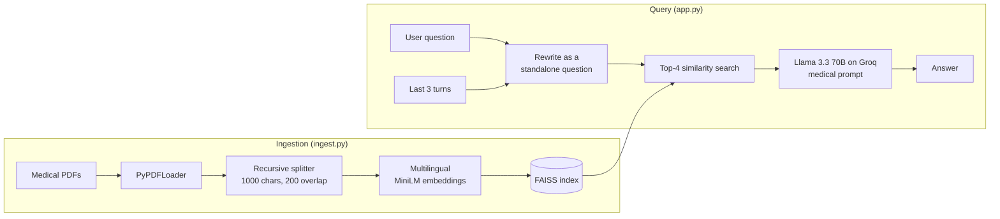

<div align="center">

# 🩺 DiabetesInsight-RAG

**A Retrieval-Augmented Generation (RAG) assistant that answers questions about Type 2 Diabetes using only official medical guidelines.**

[](https://diabetesinsight-rag-jnv7zjh9qqtgmfat6nr7ke.streamlit.app/)


</div>

> The demo is hosted on Streamlit Community Cloud. If it has been idle, click **"Yes, get this app back up!"** and give it a minute to wake up. The interface and answers are in Spanish.

## Why RAG?

General-purpose LLMs can sound confident while being wrong, which is dangerous in medicine. DiabetesInsight-RAG grounds every answer in a curated set of official documents and tells the user which parts come from those sources.

**Knowledge base** (6 PDFs in [`data/raw/`](data/raw)):

- World Health Organization (WHO)
- American Diabetes Association (ADA) – *Standards of Care in Diabetes*
- Instituto Mexicano del Seguro Social (IMSS) – clinical practice guideline
- PRONAM and Mexican clinical protocols for Type 2 Diabetes
- A patient education pack for people newly diagnosed with Type 2 Diabetes

## Architecture



1. **Ingestion.** PDFs are split into overlapping chunks and embedded with `paraphrase-multilingual-MiniLM-L12-v2`, which handles both the Spanish and English documents. Vectors are stored in a local FAISS index.
2. **Contextualisation.** Follow-up questions ("and what about its treatment?") are rewritten into standalone questions using the last 3 conversation turns.
3. **Retrieval.** FAISS returns the 4 most similar chunks.
4. **Generation.** `llama-3.3-70b-versatile` on Groq (temperature 0.3) answers with a medical prompt that prioritises the retrieved context and flags anything that comes from general knowledge.

## Features

- **Grounded answers** from official guidelines, with a strict medical prompt.
- **Conversational memory**: a sliding window of recent turns in `st.session_state`.
- **Fast inference** on Groq LPUs.
- **Auto-ingestion**: if the FAISS index does not exist (for example on first deploy), the app builds it from the PDFs automatically.
- **Secrets handling**: reads keys from `st.secrets` in the cloud and from `.env` locally.
- **Custom UI**: dark theme, custom avatars and suggested starter questions.

## Tech stack

| Component | Technology |
|---|---|
| Orchestration | LangChain |
| LLM | Llama 3.3 70B via Groq |
| Embeddings | `sentence-transformers/paraphrase-multilingual-MiniLM-L12-v2` |
| Vector store | FAISS (CPU) |
| PDF parsing | PyPDF |
| Front end and hosting | Streamlit / Streamlit Community Cloud |

## Run it locally

### 1. Install

```bash
git clone https://github.com/GaneshaDS/DiabetesInsight-RAG.git
cd DiabetesInsight-RAG

python -m venv venv
# Windows
venv\Scripts\activate
# Linux / macOS
source venv/bin/activate

pip install -r requirements.txt
```

### 2. Add your API key

Get a free key at [console.groq.com](https://console.groq.com) and put it in a `.env` file in the project root:

```env
GROQ_API_KEY=your_groq_api_key
```

Or copy [`.streamlit/secrets.toml.example`](.streamlit/secrets.toml.example) to `.streamlit/secrets.toml` and fill it in.

### 3. Run

```bash
streamlit run src/app.py
```

The first launch builds the FAISS index from the PDFs, which takes a minute. You can also build it ahead of time:

```bash
python src/ingest.py
```

## Project structure

```
DiabetesInsight-RAG/
├── .streamlit/
│   ├── config.toml               # Theme
│   └── secrets.toml.example      # Template for API keys
├── data/
│   └── raw/                      # Official medical PDFs
├── src/
│   ├── ingest.py                 # PDF loading, chunking, embeddings, FAISS
│   ├── app.py                    # Streamlit app and RAG pipeline
│   └── styles.py                 # Custom CSS
├── vectorstore/                  # FAISS index (generated, not tracked)
└── requirements.txt
```

## Roadmap

- [ ] Show the source document and page for each answer
- [ ] Highlight cited passages
- [ ] Evaluate answer quality with a test set (e.g. RAGAS)
- [ ] Docker image
- [ ] English interface option

## ⚠️ Medical disclaimer

This project is for **academic and informational purposes only**. It is **not** a substitute for professional medical advice, diagnosis or treatment. Always consult a licensed healthcare professional.

## Author

**Heriberto Ganesha Cortés Valdez** · [LinkedIn](https://www.linkedin.com/in/heriberto-ganesha-cort%C3%A9s-valdez-28bbb72b7/) · [ganesha.dev@outlook.com](mailto:ganesha.dev@outlook.com)

## License

Code released under the [MIT License](LICENSE). The PDFs in `data/raw/` belong to their respective publishers and are included for educational purposes.
